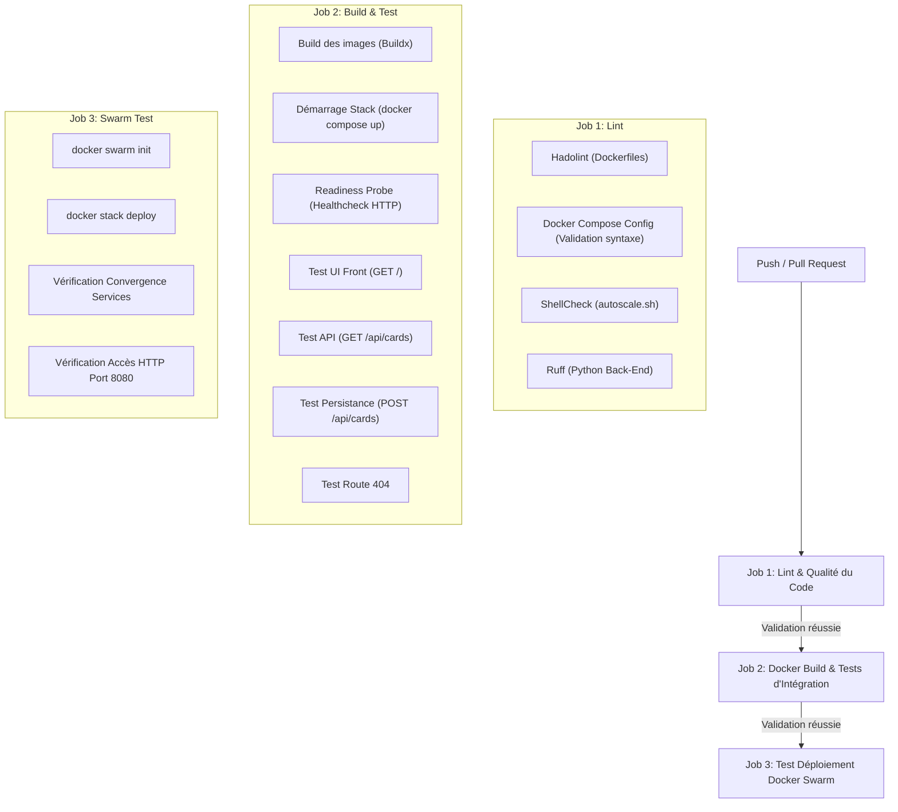

# Projet TP Docker - Cloud Personnel Virtuel (ManaCache)


## Présentation du Projet

Ce projet consiste à concevoir une application web modulaire nommée **ManaCache** (gestionnaire de collection Magic: The Gathering) basée sur Docker, Docker Compose et Docker Swarm. L'architecture repose sur des conteneurs personnalisés construits à partir d'images de base officielles et optimisées (`alpine`, `python:slim`, `nginx:alpine`), sans dépendre d'images tierces opaques.

### Schéma de l'Architecture

```text
                 [ Réseau Externe / Hôte ]
                            │
                       Port 8080
                            │
               ┌────────────▼─────────────┐
               │                          │
               │   Reverse Proxy (Nginx)  │
               │    (Routage & Sécurité)  │
               │                          │
               └──────┬────────────┬──────┘
                      │            │
             /--------/            \--------\  [ Réseau Interne Isolé : app-net ]
             │                              │
      Requêtes vers /                Requêtes vers /api
             │                              │
    ┌────────▼────────┐            ┌────────▼────────┐
    │                 │            │                 │
    │  Front (Nginx)  │            │  Back (Python)  │
    │  (Fichiers UI)  │            │  (Logique API)  │
    │                 │            │                 │
    └─────────────────┘            └────────┬────────┘
                                            │
                                  /---------┴---------\
                                  │                   │
                        ┌─────────▼────────┐ ┌────────▼─────────┐
                        │ Volume mtg_data  │ │Volume mtg_images │
                        │  (JSON / SQLite) │ │ (Cache des scans)│
                        └──────────────────┘ └──────────────────┘
```

---

## 1. Choix de Build et Personnalisation des Images

### A. Le Reverse Proxy (`/proxy`)
- **Image de base :** `nginx:alpine` pour sa légèreté, sa rapidité et sa surface d'attaque réduite.
- **Opérations OS :** Mise à jour des paquets `apk`, installation de `curl` pour les tests de santé, et nettoyage du cache.
- **Configuration :** Suppression du fichier par défaut et intégration d'un `nginx.conf` personnalisé. Il route le trafic racine (`/`) vers le front et le trafic `/api` vers le back.
- **Ports ouverts :** Port `80` en interne.

### B. Le Front-End (`/front`)
- **Image de base :** `nginx:alpine`.
- **Opérations OS :** Installation de `curl` et nettoyage du cache.
- **Configuration :** Intégration de l'interface `index.html` (Vanilla JS interagissant avec l'API) et application de permissions strictes (`chown` et `chmod`).
- **Ports ouverts :** Port `80` en interne.

### C. Le Back-End (`/back`)
- **Image de base :** `python:3.11-slim`.
- **Sécurité et Permissions :** Création d'un utilisateur non-root (`appuser`). Création préalable des dossiers `/app/data` et `/app/images` avec les bons droits (`chown`) pour éviter les conflits de permissions avec les volumes Docker.
- **Stabilité :** Interception des signaux `SIGTERM` dans le code Python pour garantir un arrêt propre (Exit Code `0` au lieu de `137`).
- **Endpoints disponibles :**
  - `GET /` & `GET /health` : Endpoint de santé retournant `{"status": "healthy"}` (Code 200).
  - `GET /api/cards` : Lecture et récupération de la collection de cartes Magic.
  - `POST /api/cards` : Ajout d'une nouvelle carte avec persistance immédiate dans le volume.
- **Ports ouverts :** Port `5000` en interne.

---

## 2. Orchestration, Réseaux et Volumes (`docker-compose.yml`)

### Variables d'Environnement (`.env`)
L'infrastructure est paramétrable via un fichier `.env` à la racine, injecté dynamiquement au *runtime* :
```env
PROXY_PORT=8080
PROXY_MODE=production
APP_ENV=production
STORAGE_TYPE=sqlite
```

### Réseau et Volumes
- **Réseau `app-net` :** Réseau overlay privé avec option `attachable: true`, assurant à la fois l'isolation des conteneurs applicatifs et l'interopérabilité directe entre `docker compose` et `docker stack`.
- **Volumes persistants :**
  - `mtg_data` : Persistance des données JSON/SQLite.
  - `mtg_images` : Cache persistant pour les visuels.

---

## 3. Autoscaling et Mode Swarm (`swarm-stack.yml` & `autoscale.sh`)

Pour gérer les pics de charge sur le composant critique (le service **Back-end**), un service d'**autoscaling personnalisé** a été mis en place.

### Architecture de l'Autoscaler
- **Composant autonome :** Basé sur une image légère `alpine:3.18` avec `docker-cli` et `bash` ([`Dockerfile.autoscaler`](file:///d:/YNOV/DOCKER%20FULLSTACK/rendu-tp1-docker-oskar-morel/Dockerfile.autoscaler)).
- **Fonctionnement :** Interroge l'API Docker en continu via le socket local (`/var/run/docker.sock`).
- **Placement Swarm :** Déployé en mode `global` avec contrainte `node.role == manager` afin de pouvoir exécuter les commandes d'orchestration `docker service scale`.
- **Seuils & Métriques :** 
  - Récupère l'utilisation CPU globale du service `back`.
  - **Scale UP (+1 réplica) :** Si la charge CPU dépasse **80%** (jusqu'à un maximum de 5 réplicas).
  - **Scale DOWN (-1 réplica) :** Si la charge CPU redescend sous **10%** (jusqu'à un minimum de 1 réplica).

---

## 4. Guide de Démarrage et Commandes

### Prérequis
- Docker Desktop (avec le moteur Docker démarré).
- Un fichier `.env` à la racine pour les variables d'environnement.

---

### A. Déploiement en Mode Swarm (avec Autoscaling)

En mode Swarm (`docker stack deploy`), Docker ne build pas les images à la volée. Il faut donc **builder les images au préalable**, puis **déployer la stack**.

#### Étape 1 : Initialiser le mode Swarm (si ce n'est pas déjà fait)
```bash
docker swarm init
```

#### Étape 2 : Construire les images localement
```bash
docker compose build
```

#### Étape 3 : Déployer la stack
```bash
docker stack deploy -c docker-compose.yml demo
```

#### Étape 4 : Vérifier l'état des services
```bash
docker stack services demo
docker service ps demo_back demo_front demo_proxy demo_autoscaler
```

#### Étape 5 : Accéder à l'application
- Interface Front-end : [http://localhost:8080/](http://localhost:8080/)
- API Back-end : [http://localhost:8080/api/cards](http://localhost:8080/api/cards)

#### Étape 6 : Arrêter la stack Swarm
```bash
docker stack rm demo
```

---

### B. Déploiement classique avec Docker Compose

Pour un cycle de développement local rapide :

```bash
# Lancement des services applicatifs en arrière-plan
docker compose up -d proxy front back

# Suivi des logs en direct
docker compose logs -f

# Arrêt et nettoyage des conteneurs et volumes
docker compose down -v
```

---

## 5. Intégration Continue (CI) avec GitHub Actions

Le projet intègre un pipeline CI complet sous GitHub Actions ([`.github/workflows/ci.yml`](file:///d:/YNOV/DOCKER%20FULLSTACK/rendu-tp1-docker-oskar-morel/.github/workflows/ci.yml)) déclenché à chaque `push` et `pull_request` sur les branches `main` / `master`, ainsi que manuellement via `workflow_dispatch`.



---

## 6. Note pour l'Évaluateur / Enseignant (Dossier Technique & Choix DevOps)

Cette section détaille les choix techniques, les exigences de qualité et les mécanismes de robustesse implémentés dans ce projet pour l'évaluation du TP.

### A. Justification des Outils de Linting (Job `lint`)
1. **Hadolint ([`.hadolint.yaml`](file:///d:/YNOV/DOCKER%20FULLSTACK/rendu-tp1-docker-oskar-morel/.hadolint.yaml)) :**
   - Garantit le respect des standards de sécurité Docker : utilisation d'un utilisateur non-root (`appuser`), minimisation des layers via chaînage `&&`, et nettoyage strict du cache des gestionnaires de paquets (`rm -rf /var/lib/apt/lists/*` et `/var/cache/apk/*`).
   - Le fichier `.hadolint.yaml` ignore pragmatiquement les règles `DL3008`/`DL3018` (pinning des versions mineures d'utilitaires de diagnostic comme `curl`), car ce pinning strict engendre des échecs de build intempestifs lorsque les miroirs Debian/Alpine archivent d'anciennes sous-versions.
2. **Docker Compose Validator (`docker compose config`) :**
   - Évite les erreurs de syntaxe, valide la cohérence des variables d'environnement interpolées et vérifie que le fichier de base `docker-compose.yml` s'associe correctement au fichier d'override `swarm-stack.yml`.
3. **ShellCheck (`autoscale.sh`) :**
   - Analyse statique du script de scaling automatique pour prévenir les erreurs de portabilité POSIX/Bash, la gestion des variables non quotées et les comportements inattendus lors des commandes Docker CLI.
4. **Ruff (Python `back/app.py`) :**
   - Valide la conformité PEP8, le tri des imports et l'absence de dead code sur l'API Python sans surcharge de temps d'exécution.

---

### B. Pourquoi des Tests d'Intégration Réels en CI ? (Job `docker-build-and-test`)
Un build Docker valide ne garantit pas que les conteneurs fonctionnent de concert une fois orchestrés. La CI démarre donc véritablement la stack complète et joue une suite de tests HTTP bout-en-bout :
- **Readiness Polling :** Une boucle d'attente active interroge le Reverse Proxy jusqu'à ce que Nginx et le Back soient pleinement initialisés (évite les *flaky tests* liés aux délais de boot).
- **Test du Routage Nginx :** Vérifie que `/` délivre l'interface HTML de ManaCache et que `/api/*` est bien proxifié vers le backend.
- **Validation du Cycle de Vie des Données (CRUD & Persistance) :**
  1. `GET /api/cards` valide la lecture initiale dans le volume `mtg_data`.
  2. `POST /api/cards` injecte une nouvelle carte.
  3. Un deuxième `GET /api/cards` confirme que la nouvelle entrée a bien été écrite et conservée dans le volume Docker partagé.
- **Vérification du code 404 :** Teste le comportement aux limites en interrogeant un endpoint inexistant.
- **Traçabilité en cas d'erreur (`docker compose logs`) :** Les logs de tous les conteneurs sont automatiquement affichés dans la console GitHub Actions en cas d'échec pour un diagnostic immédiat.

---

### C. Validation du Cluster Swarm & Autoscaling (Job `swarm-deployment-test`)
- Le runner GitHub Actions (`ubuntu-latest`) dispose des privilèges Docker complets, ce qui est mis à profit pour initialiser un cluster Swarm éphémère (`docker swarm init`).
- La stack est déployée avec `docker stack deploy`, validant le placement global de l'autoscaler, le montage du socket Docker hôte (`/var/run/docker.sock`) et la bonne publication du port d'ingress `8080`.

---

### D. Points Techniques Notables & Robustesse
- **Interception du signal `SIGTERM` :** Implémentée dans `app.py` via le module `signal`. Docker envoie un `SIGTERM` lors d'un `docker stop` ou d'un redimensionnement Swarm ; l'application s'arrête proprement avec le code `0` au lieu d'être brutalement tuée par un `SIGKILL` (Exit Code `137`).
- **Gestion des permissions Volumes :** Les répertoires `/app/data` et `/app/images` sont pré-créés dans le Dockerfile avec attribution explicite des droits à `appuser:appuser`, évitant les erreurs d'écriture `Permission Denied` lorsque Docker monte des volumes hôtes root par défaut.
- **Healthcheck HTTP non-bloquant :** L'endpoint `/health` et `/` a été implémenté pour correspondre exactement à la directive `HEALTHCHECK` du Dockerfile, assurant que Docker Swarm ne considère pas le service back comme défaillant.
- **Normalisation des fins de lignes ([`.gitattributes`](file:///d:/YNOV/DOCKER%20FULLSTACK/rendu-tp1-docker-oskar-morel/.gitattributes)) :** Force l'encodage `LF` (format UNIX) pour les fichiers `.sh`, évitant les erreurs classiques d'interpréteur (`/bin/sh^M: bad interpreter`) causées par les retours `CRLF` sous Windows.

---

### E. Synthèse des Commandes pour l'Évaluation

Pour tester l'intégralité du projet en local :

```bash
# 1. Vérification statique des Dockerfiles et scripts
docker run --rm -v "${PWD}:/mnt" -w /mnt hadolint/hadolint hadolint back/dockerfile front/dockerfile proxy/dockerfile Dockerfile.autoscaler
docker compose config --quiet

# 2. Test complet en mode Compose
docker compose up -d proxy front back
curl -s http://localhost:8080/
curl -s http://localhost:8080/api/cards
docker compose down -v

# 3. Test complet en mode Swarm
docker swarm init
docker compose build
docker stack deploy -c docker-compose.yml demo
docker stack services demo
docker stack rm demo
```

docker compose build
docker stack deploy -c docker-compose.yml demo
docker stack services demo
docker stack rm demo
```
docker swarm init
